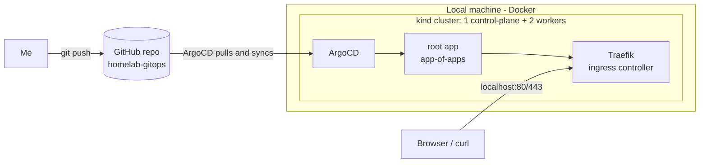

# homelab-gitops
 
A local Kubernetes homelab managed with **GitOps**. The Git repository is the single source of truth: pushing a change to `main` is the only way anything gets deployed to the cluster.
 
Built on my own machine (Omarchy / Arch Linux) as a hands-on project to learn and demonstrate platform engineering practices: Kubernetes, ArgoCD, Helm, observability and security.
 
> **Status:** work in progress. See the [Roadmap](#roadmap) for what is done and what is next.
 
## Architecture
 

 
**How it works**
 
1. `make up` creates the kind cluster, installs ArgoCD and applies the `root` Application.
2. `root` watches the `apps/` folder of this repo. Every YAML in it is itself an ArgoCD `Application`.
3. ArgoCD keeps the cluster in sync with Git (`automated`, `prune`, `selfHeal`). Manual changes in the cluster are reverted.
4. Adding a new service = adding a YAML in `apps/`, commit and push.

> **Detailed design:** [docs/architecture.md](docs/architecture.md)

## Stack
 
| Component | Purpose |
|---|---|
| [kind](https://kind.sigs.k8s.io/) | Local multi-node Kubernetes cluster running inside Docker |
| [ArgoCD](https://argo-cd.readthedocs.io/) | GitOps controller that syncs the cluster with this repo |
| [Traefik](https://traefik.io/) | Ingress controller (HTTP/HTTPS entrypoint to the cluster) |
| [Helm](https://helm.sh/) | Packaging of third-party applications (charts) |
| Make | Single-command bootstrap and teardown |
 
## Repository structure
 
```
homelab-gitops/
├── bootstrap/
│   ├── kind-config.yaml     # Cluster definition (nodes, port mappings, labels)
│   └── root-app.yaml        # ArgoCD root Application (app-of-apps)
├── apps/                    # One ArgoCD Application per service (watched by root)
│   ├── cert-manager.yaml
│   ├── cert-manager-issuers.yaml
│   ├── kube-prometheus-stack.yaml
│   ├── monitoring.yaml
│   ├── sops-secrets-operator.yaml
│   ├── traefik.yaml
│   └── whoami.yaml
├── manifests/               # Custom manifests / values referenced by apps
├── docs/                    # Extra documentation
├── Makefile
├── renovate.json            # Automated dependency update PRs
├── .sops.yaml               # Which files SOPS encrypts, and with which age public key
└── README.md
```
 
`bootstrap/` holds what is applied **manually once** to start the cluster. `apps/` and `manifests/` are managed by GitOps.
 
## Prerequisites
 
- Linux with Docker running
- [kind](https://kind.sigs.k8s.io/), [kubectl](https://kubernetes.io/docs/tasks/tools/), [Helm](https://helm.sh/), [argocd CLI](https://argo-cd.readthedocs.io/en/stable/cli_installation/), make
On Arch Linux:
 
```bash
sudo pacman -S kubectl helm k9s kind argocd sops age
```

- An age key for SOPS (see [Secrets](#secrets-sops--age)). On a fork, generate your own and put its public key in `.sops.yaml`:

```bash
mkdir -p ~/.config/sops/age
age-keygen -o ~/.config/sops/age/keys.txt && chmod 600 ~/.config/sops/age/keys.txt
```
 
## Quick start
 
```bash
git clone https://github.com/pablofc18/homelab-gitops.git
cd homelab-gitops
 
# 1. Point the root app to your fork
#    Edit bootstrap/root-app.yaml and set spec.source.repoURL
 
# 2. Create the cluster, install ArgoCD and start syncing
make up
 
# 3. Check everything
make status
```
 
Verify the ingress is listening (a `404` from Traefik is the expected response for unknown hosts):
 
```bash
curl -i http://localhost
```
 
Verify TLS end to end with the `whoami` test app. Its certificate is signed by the lab's own CA, so pass that CA to `curl`:
 
```bash
kubectl get secret homelab-ca -n cert-manager -o jsonpath='{.data.ca\.crt}' | base64 -d > homelab-ca.crt
curl --cacert homelab-ca.crt https://whoami.localhost
```

### Secrets (SOPS + age)

Secrets live in Git encrypted with [SOPS](https://github.com/getsops/sops) and an [age](https://github.com/FiloSottile/age) key, as `SopsSecret` resources in files named `*.sops.yaml` under `manifests/`. [sops-secrets-operator](https://github.com/isindir/sops-secrets-operator) decrypts them inside the cluster and creates the real `Secret`, so ArgoCD never sees plain-text values.

- The age **private** key stays on the host (`~/.config/sops/age/keys.txt`) and is never committed. `make up` loads it into the cluster as the Secret `sops-age-key` (the only secret not managed from Git); `make sops-key` does the same on an existing cluster.
- **Back up the private key** (e.g. in a password manager). Without it, nothing encrypted in this repo can be decrypted again.
- Encrypt in place before committing: `sops -e -i manifests/<app>/<name>.sops.yaml`. Edit later with `sops manifests/<app>/<name>.sops.yaml`. CI fails if any `*.sops.yaml` is not encrypted.
- Example: `manifests/whoami/whoami-test-secret.sops.yaml` becomes the Secret `whoami-test` in the `whoami` namespace.
 
### Access the ArgoCD UI
 
```bash
make argocd-password   # initial admin password
make argocd-ui         # port-forward, keep it running
```
 
Open <https://localhost:8080> (self-signed certificate warning is expected) and log in as `admin`.
 
### Tear down
 
```bash
make destroy
```
 
The cluster is disposable by design: everything can be rebuilt from this repo with `make up`.
 
## Make targets
 
| Target | Description |
|---|---|
| `make up` | Create the cluster, install ArgoCD and apply the root app |
| `make destroy` | Delete the cluster |
| `make status` | Show nodes, ArgoCD applications and all pods |
| `make argocd-ui` | Port-forward the ArgoCD UI to `localhost:8080` |
| `make argocd-password` | Print the initial ArgoCD admin password |
| `make sops-key` | Load the local age private key into the cluster (also run by `make up`) |
| `make lint` | Run `yamllint` on the repo |
| `make validate` | Render all apps and validate them with `kubeconform` |
| `make scan` | Render all apps and scan them with Trivy (fails on HIGH/CRITICAL) |
 
## Design decisions
 
- **kind instead of a VM-based cluster (for now):** starts in about a minute and is easy to destroy and recreate, ideal for iterating on GitOps. A k3s-on-VMs iteration is planned (see roadmap).
- **App-of-apps pattern:** a single `root` Application bootstraps every other one, so the bootstrap is a single `kubectl apply`.
- **Traefik instead of ingress-nginx:** the Kubernetes project retired ingress-nginx in March 2026 and no longer maintains it, so I chose an actively maintained controller. Gateway API is a candidate for a later iteration.
- **`hostPort` + `nodeSelector` for ingress:** kind has no cloud load balancer. Traefik binds ports 80/443 on the control-plane node, which kind maps to the host. In a cloud cluster this would be a `LoadBalancer` Service.
- **`prune` and `selfHeal` enabled:** Git is authoritative. Resources removed from Git are removed from the cluster, and manual drift is reverted.

## Known limitations
 
- kind clusters are meant for development, not for staying up across reboots. After a reboot the node containers may need to be started again, or the cluster recreated with `make destroy && make up`.
- No persistent data worth keeping yet. Stateful apps will need backups before they hold real data.

## Roadmap
 
- [x] kind cluster with 3 nodes
- [x] ArgoCD with app-of-apps bootstrap
- [x] Traefik ingress controller
- [x] Pin all chart versions
- [x] CI: `yamllint`, `kubeconform` and Trivy on pull requests
- [x] Renovate for automated dependency updates
- [x] cert-manager (TLS) with a local CA
- [x] kube-prometheus-stack: Prometheus, Alertmanager, node-exporter, kube-state-metrics
- [x] Secrets management with SOPS + age (sops-secrets-operator)
- [x] Grafana at `https://grafana.localhost`, admin credentials from SOPS
- [ ] First real applications (e.g. Vaultwarden, Gitea)
- [ ] Observability: dashboards, alerts and SLOs

## What I'm learning

This project is my sandbox for learning Kubernetes and exploring platform engineering practices, including declarative infrastructure, reconciliation loops, ingress, Helm, and observability.
