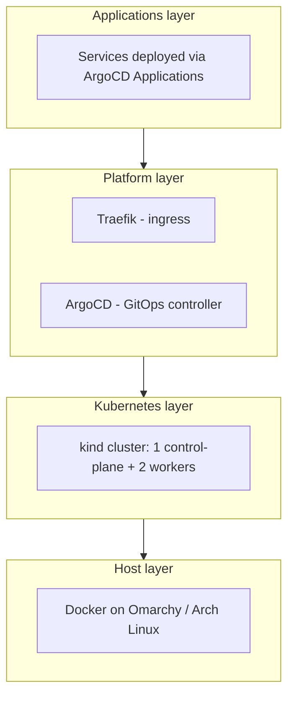
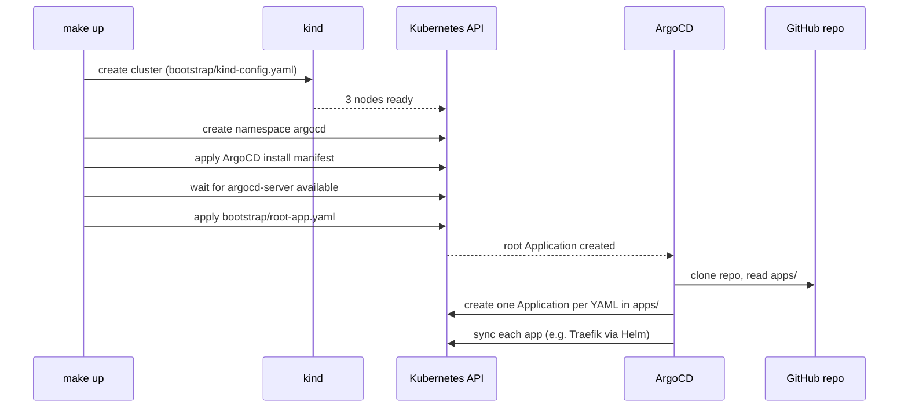
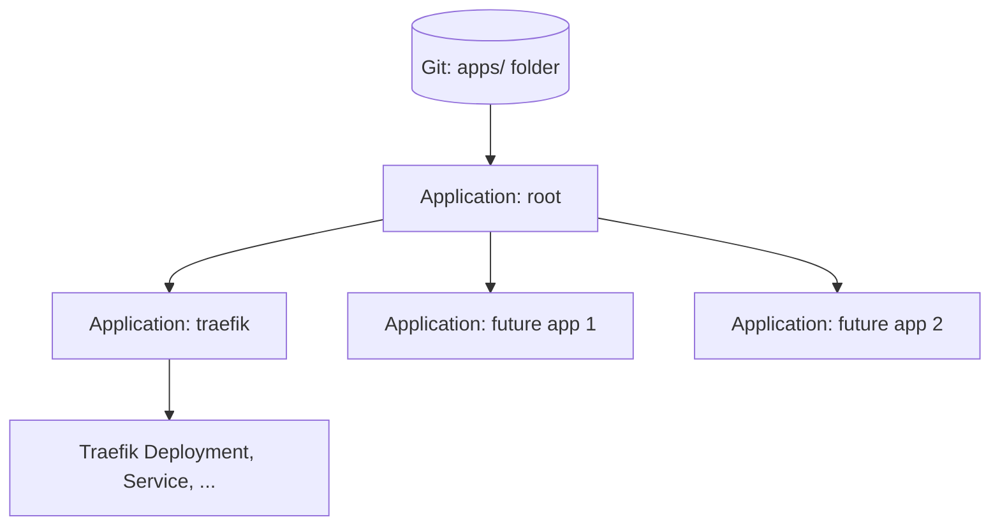
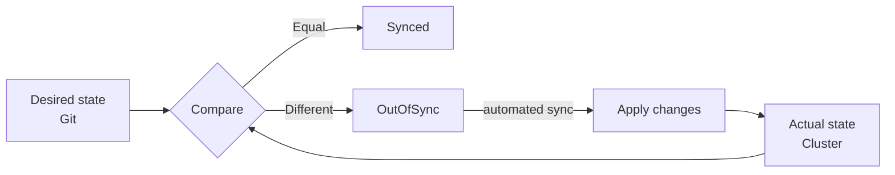
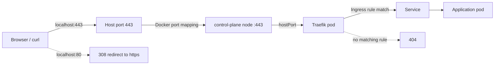

# Architecture

This document explains how the homelab is built, how its pieces interact and why the main design decisions were made. For setup instructions see the [README](../README.md).

## 1. Goals

- **Declarative:** the desired state of the cluster lives in Git.
- **Reproducible:** the whole environment can be rebuilt from scratch with one command.
- **Disposable:** destroying the cluster is cheap and safe, because nothing important lives only inside it.
- **Realistic:** use the same tools and patterns found in production platform engineering.

## 2. Layers



| Layer | Components | Managed by |
|---|---|---|
| Host | Docker, Linux | Manual (my workstation) |
| Kubernetes | kind cluster (3 nodes as containers) | `make up` / `bootstrap/kind-config.yaml` |
| Platform | ArgoCD, Traefik | ArgoCD itself (Traefik) and bootstrap (ArgoCD) |
| Applications | Future services | ArgoCD, from `apps/` |

## 3. Cluster topology

```
Host (Docker)
├── homelab-control-plane   label: ingress-ready=true
│                           host ports 80 and 443 mapped to the node
├── homelab-worker
└── homelab-worker2
```

- Every Kubernetes node is a Docker container created by kind.
- Only the control-plane node publishes ports 80 and 443 to the host (`extraPortMappings`). That is why Traefik is scheduled there.
- The control-plane node carries the label `ingress-ready=true`, which Traefik's `nodeSelector` matches.

## 4. Bootstrap flow

What `make up` does, in order:



Only two things are applied by hand: the ArgoCD install and `root-app.yaml`. Everything else comes from Git.

## 5. App-of-apps pattern



- `root` points to the `apps/` folder of this repo.
- Each file in `apps/` is itself an ArgoCD `Application`.
- Each of those apps points to its own source: a Helm chart repository, or a path inside this repo (`manifests/`).
- Adding a service means adding one file to `apps/`. Removing one means deleting the file (`prune` cleans the cluster).
- `root` syncs all apps at the same time, there is no ordering between them. An app that uses another app's CRDs (e.g. `cert-manager-issuers` needs cert-manager's `ClusterIssuer` CRD and webhook) adds `SkipDryRunOnMissingResource=true` and a `retry` policy, so on a fresh cluster it keeps retrying until its dependency is ready.

## 6. Reconciliation loop

ArgoCD runs a continuous control loop:



| Setting | Effect |
|---|---|
| `automated` | Syncs without manual approval |
| `prune: true` | Deletes cluster resources that were removed from Git |
| `selfHeal: true` | Reverts manual changes made directly in the cluster |
| `CreateNamespace=true` | Creates the destination namespace if it does not exist |

Git is polled periodically (about every 3 minutes by default). A manual refresh in the UI forces an immediate check.

## 7. Network path

How a request reaches a service:



- Port 80 only redirects: the `web` entrypoint answers every request with a permanent `308` to the same URL over HTTPS, so no service is ever served in plain text. `308` (not `301`) keeps the method and body, so a redirected `POST` stays a `POST`.
- For hosts without an Ingress rule, Traefik answers `404` over HTTPS, with its built-in self-signed default certificate (no Ingress means no cert-manager certificate). That confirms the path from host to Traefik works.
- TLS terminates at Traefik. An Ingress with the `cert-manager.io/cluster-issuer: homelab-ca` annotation and a `spec.tls` section makes cert-manager create a `Certificate` (owned by the Ingress) and store it in the Secret named in `spec.tls`, which Traefik serves on port 443. `whoami.localhost` is the reference example.
- Hostnames use `*.localhost`, which resolves to `127.0.0.1` without DNS (RFC 6761). kind-specific: a real setup would use a real domain and an ACME issuer.
- Inside the cluster, Traefik's own Service is `ClusterIP`: external traffic does not enter through it, but through the `hostPort`.
- In a cloud environment this would be replaced by a `LoadBalancer` Service in front of Traefik.

## 8. Traefik configuration for kind

| Value | Why |
|---|---|
| `service.spec.type: ClusterIP` | kind has no cloud load balancer, so `LoadBalancer` would stay pending |
| `ports.web.hostPort: 80`, `ports.websecure.hostPort: 443` | Bind the node ports mapped to the host |
| `nodeSelector: ingress-ready=true` | Run only on the node that exposes the ports |
| `tolerations` for `node-role.kubernetes.io/control-plane` | Control-plane nodes are tainted by default; this lets Traefik run there |
| `updateStrategy.rollingUpdate: maxUnavailable: 1, maxSurge: 0` | With `hostPort` on a single node, the default surge rollout deadlocks: the new pod stays `Pending` because the old one holds ports 80/443. Replacing the pod costs a few seconds of downtime per upgrade |
| `providers.kubernetesIngress.ingressEndpoint.ip: 127.0.0.1` (and `publishedService.enabled: false`) | Traefik writes this address into every Ingress status. Copying it from the `ClusterIP` Service would leave it empty, and ArgoCD reports Ingresses without an address as `Progressing` forever |

## 9. Repository layout and ownership

| Path | Purpose | Applied by |
|---|---|---|
| `bootstrap/kind-config.yaml` | Cluster definition for the `kind` tool | `make up` (manual, once) |
| `bootstrap/root-app.yaml` | Entry point of GitOps | `make up` (manual, once) |
| `apps/` | ArgoCD Applications, one per service | ArgoCD (via `root`) |
| `manifests/` | Raw manifests and values used by apps | ArgoCD |
| `docs/` | Documentation | n/a |

`kind-config.yaml` is deliberately kept out of `apps/`: it is not a Kubernetes resource and exists before the cluster does.

## 10. Design decisions and trade-offs

| Decision | Alternative | Reasoning |
|---|---|---|
| kind | k3s on VMs, minikube | Fastest to create and destroy; ideal for iterating. Less persistent across reboots. VM-based k3s is planned as phase 2. |
| ArgoCD | Flux | Widely used, strong UI that helps while learning. |
| App-of-apps | ApplicationSet | Simpler to understand first; ApplicationSet can be adopted later. |
| Traefik | ingress-nginx | ingress-nginx was retired by the Kubernetes project in March 2026 and is no longer maintained. |
| Public repo | Private repo with credentials | No credential setup needed for ArgoCD, and the repo doubles as a portfolio. Secrets must never be committed in plain text. |
| Helm for third-party apps | Raw manifests | Charts handle complexity; values stay in Git. |
| Local CA (`homelab-ca` ClusterIssuer) | ACME / Let's Encrypt | kind-specific: no public domain, so ACME cannot validate ownership. cert-manager runs its own CA, bootstrapped by a self-signed issuer. The CA has an X.509 name constraint (`*.localhost` only), so trusting it on the host cannot be abused to impersonate other domains. With a real domain this becomes an ACME issuer with DNS-01; Certificates and Ingresses stay the same. |
| No scraping of kube-controller-manager, kube-scheduler, etcd and kube-proxy | Patch kind's kubeadm config to bind their metrics on `0.0.0.0` | kind-specific: they only listen on the node's `127.0.0.1`, so their targets are always down and their alerts always fire. Exposing them needs a `kind-config.yaml` change and a cluster rebuild; revisit in phase 2 (k3s). |
| Grafana with a namespaced Role, sidecars watching only `monitoring` | Chart default: sidecars search all namespaces | The default ClusterRole grants list/watch on every Secret in the cluster (the chart cannot split ConfigMaps from Secrets). Dashboards have to be ConfigMaps in `monitoring`, which is where they live anyway. |
| Grafana admin password from a `SopsSecret` (`admin.existingSecret`) | Chart-generated random password | The chart generates it with Helm `lookup`, which ArgoCD's `helm template` cannot run, so the password and the app's sync status would change on every render. |
| cert-manager for the prometheus-operator webhook certificate | Chart's Helm hook Jobs (`kube-webhook-certgen`) | Hook Jobs are re-run by ArgoCD on every sync. cert-manager is already in the cluster and keeps the certificate renewed. |
| sops-secrets-operator (decrypt in the cluster) | KSOPS / helm-secrets plugins in ArgoCD's repo-server | Follows ArgoCD's recommendation of destination-cluster secret management: ArgoCD only sees encrypted resources. Needs no changes to the ArgoCD installation, which the Makefile applies from the upstream manifest. |
| Retry for dependent apps | Sync waves between Applications | Waves on `Application` resources need a custom health check in `argocd-cm`, which is not managed from Git yet. Retrying is simpler and self-healing. |

## 11. Failure modes and recovery

| Scenario | Behaviour | Recovery |
|---|---|---|
| Someone edits a resource with `kubectl` | ArgoCD reverts it (`selfHeal`) | None needed |
| A file is deleted from `apps/` | The app and its resources are pruned | Restore the file via Git |
| Host reboot | Port-forwards stop; kind node containers may not restart cleanly | `docker start` the node containers, or `make destroy && make up` |
| Cluster is destroyed | All in-cluster state is lost | `make up` rebuilds everything from Git |
| Bad commit breaks an app | App becomes `Degraded` or `OutOfSync` | `git revert` and push |

State that is **not** stored in Git (application data, persistent volumes) is lost when the cluster is destroyed. Stateful services will require backups before they are used for real data.

## 12. Security considerations

Current state and planned improvements:

- The ArgoCD initial admin password should be changed and the initial secret removed.
- ArgoCD UI is only reachable through a local `port-forward`; it is not exposed.
- Secrets are stored in the repo only encrypted with SOPS + age, as `SopsSecret` resources. sops-secrets-operator decrypts them in the cluster, so plain-text values never pass through ArgoCD (repo-server, cache or Redis).
- The age private key is the "secret zero": it cannot be in Git because it protects everything else. It stays on the host and `make up` loads it into the Secret `sops-age-key`. Anyone who can read that Secret can decrypt every secret in the repo.
- Supply chain: every chart, CLI tool and the ArgoCD manifest are pinned to exact versions, and GitHub Actions to commit digests. CI validates (`kubeconform`) and scans (Trivy) the rendered manifests on every PR.
- Renovate proposes version bumps as pull requests, so every update goes through the same CI checks before it reaches `main`. New releases must be at least 3 days old (`minimumReleaseAge`), which leaves time for a compromised release to be detected and pulled before it is proposed.

## 13. Planned evolution

1. Pin all versions and add Renovate.
2. Add CI validation (`yamllint`, `kubeconform`, Trivy).
3. Add cert-manager and TLS.
4. Add kube-prometheus-stack for metrics, dashboards and alerting.
5. Add SOPS + age for secrets.
6. Deploy real applications.
7. Phase 2: move to a multi-VM k3s cluster provisioned with Terraform (libvirt) and configured with Ansible, keeping the same GitOps repo.
